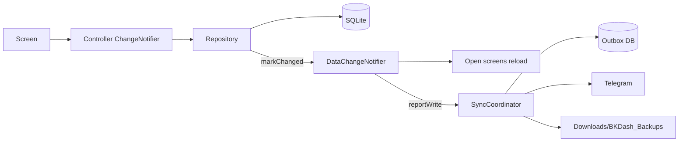

# Bkdash Sanitary Ware · بكداش

[](https://github.com/Omar-Bkdash-7/bkdash-sanitary-ware/actions/workflows/ci.yaml)
[](https://flutter.dev)
[](https://dart.dev)
[](#requirements)

An offline-first Flutter app for running a sanitary-ware shop: inventory, invoices, customers, debts,
payments and reports. Everything lives in a local SQLite database on the phone — no cloud, no account,
no internet needed to sell. Invoices become Arabic A4 PDFs, and every change can be mirrored to a
private Telegram chat and to a small Python bridge on the shop computer.

> The interface is entirely Arabic (RTL). Code, comments and this document are English.

---

## Table of contents

- [Features](#features)
- [Requirements](#requirements)
- [Getting started](#getting-started)
- [How it is built](#how-it-is-built)
- [Business rules](#business-rules)
- [Security](#security)
- [Backups and restore](#backups-and-restore)
- [Telegram delivery](#telegram-delivery)
- [Desktop bridge (optional)](#desktop-bridge-optional)
- [Invoice PDFs](#invoice-pdfs)
- [Testing and CI](#testing-and-ci)
- [Release signing](#release-signing)
- [Troubleshooting](#troubleshooting)
- [Limitations](#limitations)

---

## Features

| Area | What it does |
|---|---|
| **Sales** | Create an invoice with cash, transfer, credit or partial payment, edit or delete an issued invoice, and take payments against customer debt. |
| **Inventory** | Items with cost/sale price, unit, category and stock; low-stock flag at or below 5 units; stock is restored automatically when an invoice is deleted or rewritten. |
| **Customers and debts** | A real customer table, per-customer balance, previous debt carried into the invoice, and payments allocated to the oldest invoices first. |
| **Reports** | Dashboard charts and sales/profit summaries over a chosen period. |
| **Security** | Four-digit PIN stored as a salted PBKDF2-HMAC-SHA256 hash, escalating lock-out after wrong attempts, optional fingerprint unlock, automatic lock after 30 seconds in the background. |
| **Invoice PDF** | A4, right-to-left, embedded Amiri font, shop header, item table with a repeated header on page breaks, totals, previous debt, notes and a page footer. |
| **Backups** | Manual `.db` snapshot to save or share, validated restore with a before/after count preview, and automatic rolling copies kept in a public phone folder. |
| **Telegram** | Each saved invoice goes to a private chat as a PDF, and one database snapshot follows a burst of changes. Failed uploads wait in an outbox and retry. |
| **Desktop bridge** | Optional Python service on the shop computer that receives invoices over the local Wi-Fi and keeps its own copy of the same database. |
| **Exports** | Excel-friendly CSV for inventory, invoices, sold items, and customers with debts. |

---

## Requirements

| Tool | Version used to build and test |
|---|---|
| Flutter | 3.47.9 (stable) — Dart 3.13 |
| JDK | 17 or newer |
| Android SDK | Platform 36, build tools 36 |
| Gradle / AGP / Kotlin | 9.3.1 / 9.1.0 / 2.4.0 (Flutter 3.47 template defaults — do not edit by hand) |
| Android device | Android 7.0 (API 24) and newer. The public backup folder needs Android 10 (API 29) and newer |

---

## Getting started

### 1. Keep the pub cache on the same drive (Windows only, once)

If the project is on `D:` and the pub cache on `C:`, an Android build fails with
`this and base files have different roots`:

```powershell
New-Item -ItemType Directory -Force D:\PubCache | Out-Null
[Environment]::SetEnvironmentVariable('PUB_CACHE', 'D:\PubCache', 'User')
```

Close every PowerShell window, VS Code and Android Studio, then reopen them.

### 2. Run

```bash
flutter pub get
flutter run                       # on a connected phone
```

### 3. Verify like CI does

```bash
dart format --output=none --set-exit-if-changed lib test
flutter analyze --fatal-infos
flutter test
flutter build apk --debug
```

On Windows there is one script for all of it; it also writes a full log to `bkdash_verify.txt`
on the desktop:

```powershell
powershell -ExecutionPolicy Bypass -File tool\verify.ps1
```

---

## How it is built

Feature-first folders, repository/service layer, `ChangeNotifier` + `Provider` for state.

```
lib/
  main.dart                  entry point
  app/                       composition root: dependencies, theme, lock gate, navigation shell
  core/
    database/                SQLite schema, seed items, snapshot and restore
    events/                  DataChangeNotifier: "data changed" + typed write reports
    formatting/              Money (integer cents), dates, validation
    storage/                 key-value store, encrypted secret store
    widgets/                 shared UI pieces
  features/
    inventory  customers  invoices  reports  security  backup  settings
    telegram   desktop_sync
      models/                plain Dart data and rules (unit-testable)
      data/                  repositories (SQL), services, platform adapters
      presentation/          controllers and screens
test/                        unit and widget tests
tool/
  verify.ps1                 format + analyze + test + debug APK
  desktop_bridge/            Python bridge for the shop computer
```

Data flow, and the two hooks every write goes through:



Money is never a `double`: `Money` stores integer cents, so totals and debts cannot drift.

---

## Business rules

- **Payment method decides the paid amount.** Cash/transfer pay the full total, credit pays nothing,
  partial pays the entered amount (strictly between 0 and the total).
- **Credit and partial sales need a registered customer;** a cash sale may be a walk-in customer.
- **One transaction per sale.** Checking stock, writing the invoice, its lines and the stock deduction
  either all succeed or all roll back.
- **Stock cannot go negative.** Selling more than the shelf holds is refused.
- **Payments settle the oldest invoices first** and cannot exceed the outstanding debt.
- **Issued invoices are snapshots.** Renaming an item or changing its price never rewrites old invoices;
  they keep the name, unit and prices they were issued with.
- **Guarded invoice edits.** An invoice that was partly settled by a later debt payment cannot be edited
  or deleted, because that payment may have covered several invoices and would corrupt the balance.
- **A customer with invoices cannot be deleted.**

---

## Security

- The PIN is stored as a **salted PBKDF2-HMAC-SHA256 hash** in the encrypted store, never in the business
  database and never in an exported snapshot.
- Five wrong attempts start a 30-second lock-out; it doubles up to 15 minutes and survives a restart.
- Fingerprint unlock is optional and only offered when the phone has an enrolled fingerprint.
- The app locks itself after 30 seconds in the background.
- The Telegram bot token and chat id live in `flutter_secure_storage`; the UI only ever shows a masked
  token, and nothing sensitive is logged.

---

## Backups and restore

Everything is reachable from **Settings → Backup and export**.

**Snapshots are consistent.** The live database file is never copied directly. The app uses
`VACUUM INTO` on SQLite 3.27+ (falling back to a copy taken inside a transaction), runs
`PRAGMA quick_check` on the result, and deletes the temporary file when it is done. Files are named
`bkdash_<yyyy-MM-dd>_<HH-mm>.db`.

**Restore is guarded.** Pick a `.db` file and the app validates it (real SQLite, `quick_check` ok,
expected tables present, schema not newer than the app), then shows a confirmation with the current and
incoming counts of invoices, customers and items. Before replacing anything it takes a safety backup of
the current data, then swaps the file through a temporary copy and rename, reopens the database and
refreshes the app.

**Rolling copies that survive uninstall.** With the switch in **Settings → Backup and export → automatic
copies**, each snapshot is also written to `Download/BKDash_Backups` through MediaStore — no all-files
permission, and the folder stays when the app is uninstalled or its data is cleared. The newest 10 copies
are kept and older ones are deleted. This needs Android 10 or newer; on older versions the switch is shown
as unavailable.

---

## Telegram delivery

Set it up once in **Settings → Link and sync → Telegram settings**:

1. Create a bot with [@BotFather](https://t.me/BotFather) and copy the bot token.
2. Send `/start` to your new bot, then read your chat id from [@userinfobot](https://t.me/userinfobot).
3. Paste both, press **Test connection**, and leave the two switches for the invoice PDF and the database
   copy on.

What is sent, and when:

- **Invoice PDF** — immediately after an invoice is saved or edited, with a plain-text Arabic caption.
- **Database snapshot** — 30 seconds after the *last* change, so a burst of edits produces one upload;
  only the newest pending snapshot is kept.
- **Outbox** — deliveries live in a separate `bkdash_sync_queue.db`, so no queue row can ever appear inside
  an uploaded or restored snapshot. Failed uploads retry with exponential backoff (1, 2, 4 … 64 minutes,
  capped at 8 attempts), respect Telegram's `retry_after`, retry on the next launch and every minute while
  something is pending, and can be pushed immediately from the send log.
- **Never blocks a sale.** Saving data never waits for the network; with no connection the job simply stays
  pending. A `sync.snapshot_dirty` flag makes the app send the owed snapshot on the next launch if it was
  killed inside the 30-second window.
- **Send log** — the cloud icon in the app bar opens the last 50 attempts with time, type, attempt count
  and the exact error.

Every snapshot caption ends with a machine-readable line for the Python importer:

```
#bkdash_sync v=1 schema=1 ts=2026-11-16T09:41:12Z invoices=250 customers=87 products=312
```

---

## Desktop bridge (optional)

`tool/desktop_bridge` is a dependency-free Python 3 service that runs on the shop computer, on the same
Wi-Fi as the phone. It receives each new invoice into `tool/desktop_bridge/data/bkdash_sanitary_ware.db`
(same tables as the app), accepts a full phone backup, and can hand a database back to the phone. The
phone is the source of truth; the flow is one-way, by design.

See [tool/desktop_bridge/README.md](tool/desktop_bridge/README.md) for the protocol and the
`start_bridge.bat` launcher.

---

## Invoice PDFs

Built with the `pdf` package and the SIL-OFL **Amiri** font (regular + bold, see
`assets/fonts/Amiri-OFL.txt`), so Arabic letterforms join correctly and numbers and dates keep their
direction. The layout is A4 with a 16-row first page and 20 rows on later pages, a repeated table header,
continuous page numbering, totals and remaining balance below the table, notes, and an optional shrunken
logo. File names are ASCII (`invoice_<n>_<yyyy-MM-dd>.pdf`) so they survive the trip through Telegram and
Windows; the Arabic title goes in the caption.

---

## Testing and CI

```bash
flutter test                 # 112 unit and widget tests
flutter test --coverage      # what CI uploads
```

Covered: money arithmetic, dates, Arabic-aware search, invoice draft rules, payment allocation, report
models, CSV writing and exports, PIN hashing against reference vectors, the lock controller (attempts,
lock-out, biometrics, auto-lock, PIN change), the numeric pad, Telegram multipart bodies, caption limits
and masking, the sync coordinator (immediate PDF, one snapshot per burst, backoff, restart recovery, and a
write that lands during a slow upload), the rolling public copies, and PDF generation.

`.github/workflows/ci.yaml` runs on pushes to `main`, on every pull request and on demand:

1. **Verify** — formatting, `flutter analyze --fatal-infos`, tests with coverage (uploaded as an artifact).
2. **Build** — a debug APK, uploaded as an artifact for 14 days.
3. **Desktop bridge** — compiles the Python service and runs its smoke test.

---

## Release signing

Without `android/key.properties` the APK is signed with the debug key, which is fine for trying it on your
own phone. To ship updates to other devices:

```bash
cp android/key.properties.example android/key.properties   # then fill in the key details
flutter build apk --release
```

**Keep the keystore file and its passwords safe.** Without them you cannot publish an update to the same
app; Android will refuse a package signed with a different key.

---

## Troubleshooting

| Symptom | Fix |
|---|---|
| `this and base files have different roots` | Pub cache and project are on different drives: set `PUB_CACHE` as in step 1, then `flutter clean` and `flutter pub get`. |
| Gradle fails after a Flutter upgrade | Do not hand-edit `android/settings.gradle.kts` or `gradle-wrapper.properties`; regenerate them from your Flutter version's template. |
| No fingerprint button | Enrol a fingerprint in the phone settings, then enable **Fingerprint login** in the app. |
| Nothing arrives on Telegram | Check the token and chat id with **Test connection**, press `/start` in the bot chat, then read the error in the send log (cloud icon in the app bar). |
| The automatic-copy switch is disabled | The phone is older than Android 10, where MediaStore downloads do not exist. |

---

## Limitations

- **Android only.** No iOS, web or desktop build is configured.
- **Single source of truth.** Data lives on the phone; there is no server and no two-way merge.
- **Background work is app-bound.** Pending deliveries retry when the app runs, not from a background
  service, so a queue that fails overnight is sent the next time the app is opened.
- **No licence file yet.** The code is the shop's own; add a licence before publishing it for reuse.
